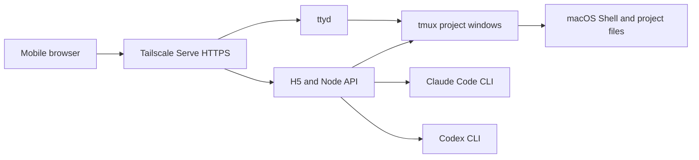

# Remote Shell Mobile

**English** | [简体中文](README.zh-CN.md)

An unofficial, self-hosted mobile workspace for macOS. It runs the real Shell, tmux, ttyd, Claude Code, and Codex CLI on your Mac, then brings project selection, live output, and terminal interaction to a mobile browser.

## Security warning

This project is a **remote command execution gateway**, not an ordinary website. Any client that can reach it may be able to read files, run commands, and use CLI sessions already authenticated as the macOS user running the service.

- Both services bind to `127.0.0.1` by default and are not directly exposed to the LAN or Internet.
- [Tailscale Serve](https://tailscale.com/kb/1242/tailscale-serve) inside a controlled tailnet is the recommended access method.
- Do not use Tailscale Funnel or map either service directly to a public port.
- The project currently has no application-level login. Tailscale device identity and Grants/ACLs are the default access boundary.

## Features

- Discover and select project directories on the Mac from a mobile browser.
- Switch between Shell, Claude Code, and Codex conversation modes.
- View the active Claude permission mode and switch among Manual, Accept Edits, Plan, and Auto by clicking the mode control or pressing `Shift+Tab`.
- Stream output through SSE and reconnect to a running task after a short network interruption or after the phone returns from the background.
- Keep Claude sessions and chat history isolated by project.
- Embed a native ttyd terminal with `Esc`, `Tab`, `Shift+Tab`, `Ctrl+C`, arrow keys, and clear-screen controls.
- Preserve project terminals with tmux and start services automatically with a macOS LaunchAgent.

## How it works



Remote Shell Mobile does not store Claude or Codex passwords and does not replace the official login flow. Commands run through CLI tools already installed and authenticated on the Mac, under the current macOS user. Usage limits and terms remain those of the corresponding provider.

## Requirements

- macOS
- Node.js `22.13.0` or newer
- `tmux`
- `ttyd`
- Tailscale, recommended for remote access
- Claude Code and/or Codex CLI, depending on which modes you want to use

The project does not install system tools automatically. Verify the commands you intend to use first:

```bash
node --version
tmux -V
ttyd --version
claude --version   # optional
codex --version    # optional
```

## Installation

```bash
git clone https://github.com/mxx1111/remote-code-mobile.git
cd remote-code-mobile
npm ci
cp .env.example .env.local
```

Edit `.env.local` and, at minimum, confirm the project root:

```bash
REMOTE_SHELL_PROJECTS_ROOT="/Users/your-name/Projects"
REMOTE_SHELL_MACHINE_NAME="My Mac"
```

Build the web app and install the per-user LaunchAgents:

```bash
npm run build
./scripts/install-launch-agents.zsh
```

The installer generates plist files using the actual repository path, so the repository can live anywhere. Logs and default session state are stored in `.runtime/`; set `REMOTE_SHELL_STATE_ROOT` if you prefer a location outside the repository.

## Access through Tailscale

Keep both bind addresses set to `127.0.0.1` in `.env.local`, then expose two HTTPS endpoints inside your tailnet:

```bash
tailscale serve --bg http://127.0.0.1:3001
tailscale serve --bg --https=7681 http://127.0.0.1:7681
tailscale serve status
```

Join the phone to the same tailnet and open the `https://<machine>.<tailnet>.ts.net/` URL shown by the first command. The embedded terminal uses HTTPS port `7681` on the same host.

If either port is already used by another Serve rule, inspect `tailscale serve status` before changing anything. When remote access fails, check the Tailscale device state, MagicDNS, and both service ports separately.

### Install on an iPhone Home Screen

After the HTTPS address works, open it in Safari, tap Share, choose **Add to Home Screen**, enable **Open as Web App**, and tap Add. The installed web app uses its own icon and standalone window without Safari browser chrome.

A one-time install hint is shown on iPhone when the page is opened in a browser. The service worker caches only the H5 shell and static assets; `/api`, Claude, Shell, SSE, and terminal traffic always connect directly to the Mac.

## Optional LAN access

Only on a fully trusted LAN, you may explicitly change `.env.local` to:

```bash
REMOTE_SHELL_HOST=0.0.0.0
REMOTE_SHELL_TTYD_HOST=0.0.0.0
```

Restart both services after changing the bind addresses:

```bash
launchctl kickstart -k gui/$(id -u)/dev.remote-shell-mobile.server
launchctl kickstart -k gui/$(id -u)/dev.remote-shell-mobile.ttyd
```

This does not add authentication and must never be used for direct Internet exposure.

## Configuration

| Variable | Default | Description |
| --- | --- | --- |
| `REMOTE_SHELL_PROJECTS_ROOT` | Parent directory of the repository | Directory whose immediate child folders can be selected as projects |
| `REMOTE_SHELL_MACHINE_NAME` | Current Mac hostname | Device name displayed in the UI |
| `REMOTE_SHELL_HOST` | `127.0.0.1` | H5/API bind address |
| `REMOTE_SHELL_PORT` | `3001` | H5/API port |
| `REMOTE_SHELL_TTYD_HOST` | `127.0.0.1` | ttyd bind address |
| `REMOTE_SHELL_TTYD_PORT` | `7681` | Local ttyd port |
| `REMOTE_SHELL_TTYD_PUBLIC_PORT` | `7681` | Port the browser uses to reach the terminal |
| `REMOTE_SHELL_STATE_ROOT` | `.runtime` inside the repository | Session, task, and log directory |
| `REMOTE_SHELL_WORKSPACE_SESSION` | `remote-shell-mobile` | tmux workspace name |
| `REMOTE_SHELL_TTYD_CREDENTIAL` | Empty | Optional ttyd Basic Auth in `user:password` format |

If a command is not available on `PATH`, configure an absolute path with `REMOTE_SHELL_NODE`, `REMOTE_SHELL_TMUX`, `REMOTE_SHELL_TTYD`, `REMOTE_SHELL_CLAUDE`, or `REMOTE_SHELL_CODEX`.

## Local development

Run the local API and Vite development server in separate terminals:

```bash
npm start
npm run dev
```

Before submitting a change, run:

```bash
npm run check
npm audit --omit=dev
```

## Updating and uninstalling

After updating the source, reinstall dependencies, rebuild, and restart the services:

```bash
npm ci
npm run build
launchctl kickstart -k gui/$(id -u)/dev.remote-shell-mobile.server
launchctl kickstart -k gui/$(id -u)/dev.remote-shell-mobile.ttyd
```

To remove the persistent services:

```bash
./scripts/uninstall-launch-agents.zsh
```

The uninstall script does not delete `.runtime` or a custom state directory.

## Data and privacy

- `.env.local`, `.runtime/`, logs, and model-session files are ignored by Git.
- Claude chat history is stored locally in `.runtime/claude-conversations.json` by default and is not uploaded to a server operated by this project.
- The project catalog API returns project names, branches, and display paths to a connected browser, so access control must exist in front of the page.
- Shell, Claude, and Codex child processes inherit the environment and file permissions of the service user.
- The H5 interface does not expose `bypassPermissions`, and the backend rejects it. The native terminal still follows the permission configuration of Claude Code itself.

See [SECURITY.md](SECURITY.md) for the security policy and [docs/ROADMAP.md](docs/ROADMAP.md) for planned work.

## Disclaimer

Remote Shell Mobile is a community project and is not affiliated with or endorsed by Anthropic, OpenAI, Tailscale, or ttyd. Claude, Claude Code, Codex, Tailscale, and other names belong to their respective owners.

## License

[Apache License 2.0](LICENSE)
