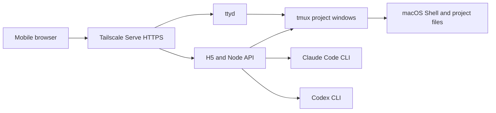

# Remote Shell Mobile

一个面向手机的 macOS 自托管工作台。它在你的 Mac 上调用真实的 Shell、tmux、ttyd、Claude Code 和 Codex CLI，并把项目列表、实时输出和终端交互带到移动浏览器。

> An unofficial, self-hosted mobile workspace for your local macOS terminal and AI coding CLIs.

## 安全提示

这是一个**远程命令执行入口**，不是普通网页。任何能访问服务的人，都可能以当前 macOS 用户权限读取文件、执行命令，并使用该用户已经登录的 CLI。

- 默认只监听 `127.0.0.1`，不会直接暴露给局域网或公网。
- 推荐通过 [Tailscale Serve](https://tailscale.com/kb/1242/tailscale-serve) 在受控 tailnet 内访问。
- 不要使用 Tailscale Funnel，也不要直接映射公网端口。
- 项目目前没有应用层登录；Tailscale 设备身份和 Grants/ACL 是默认访问边界。

## 功能

- 从手机动态读取并选择 Mac 上的项目目录。
- 在 Shell、Claude Code、Codex 三种对话模式之间切换。
- 在 H5 中显示 Claude 权限模式；点击模式按钮或按 `Shift+Tab`，可在 Manual、Accept Edits、Plan 和 Auto 之间切换。
- 通过 SSE 实时返回输出，短时断网或手机切后台后可以重新连接仍在运行的任务。
- 按项目保存 Claude 会话和聊天记录，项目之间互不串线。
- 嵌入 ttyd 原生终端，并提供 `Esc`、`Tab`、`Shift+Tab`、`Ctrl+C`、方向键和清屏按钮。
- 使用 tmux 保留项目终端；使用 LaunchAgent 在 macOS 用户登录后自动运行。

## 工作原理



应用本身不保存 Claude 或 Codex 密码，也不代替官方登录。模型命令由 Mac 上已经安装并登录的 CLI 以当前用户身份运行，额度和服务条款仍由对应提供方决定。

## 环境要求

- macOS
- Node.js `22.13.0` 或更高版本
- `tmux`
- `ttyd`
- Tailscale，推荐用于远程访问
- Claude Code、Codex CLI，可按实际需要任选安装

项目不会自动安装这些系统工具。请先确认相应命令能在终端中运行：

```bash
node --version
tmux -V
ttyd --version
claude --version   # 可选
codex --version    # 可选
```

## 安装

```bash
git clone https://github.com/mxx1111/remote-code-mobile.git
cd remote-code-mobile
npm ci
cp .env.example .env.local
```

编辑 `.env.local`，至少确认项目根目录：

```bash
REMOTE_SHELL_PROJECTS_ROOT="/Users/your-name/Projects"
REMOTE_SHELL_MACHINE_NAME="My Mac"
```

随后构建页面并安装用户级 LaunchAgent：

```bash
npm run build
./scripts/install-launch-agents.zsh
```

安装器会根据当前仓库的真实路径生成 plist，因此仓库可以放在任意目录。服务日志和默认会话状态保存在 `.runtime/`；也可以通过 `REMOTE_SHELL_STATE_ROOT` 放到仓库外。

## 通过 Tailscale 访问

保持 `.env.local` 中两个监听地址均为 `127.0.0.1`，然后在 Mac 上配置两个 tailnet 内的 HTTPS 入口：

```bash
tailscale serve --bg http://127.0.0.1:3001
tailscale serve --bg --https=7681 http://127.0.0.1:7681
tailscale serve status
```

手机加入同一 tailnet 后，打开第一条命令输出的 `https://<machine>.<tailnet>.ts.net/` 地址。原生终端会使用同一主机的 HTTPS `7681` 端口。

如果端口已经被其他 Tailscale Serve 规则占用，请先查看 `tailscale serve status`，不要直接覆盖现有配置。远程不可用时，分别检查 Tailscale 设备状态、MagicDNS 和两个服务端口。

## 可选的局域网模式

只有在完全可信的局域网中，才可以显式修改 `.env.local`：

```bash
REMOTE_SHELL_HOST=0.0.0.0
REMOTE_SHELL_TTYD_HOST=0.0.0.0
```

修改后重启服务：

```bash
launchctl kickstart -k gui/$(id -u)/dev.remote-shell-mobile.server
launchctl kickstart -k gui/$(id -u)/dev.remote-shell-mobile.ttyd
```

这不会增加身份认证，不能用于公网暴露。

## 配置项

| 变量 | 默认值 | 说明 |
| --- | --- | --- |
| `REMOTE_SHELL_PROJECTS_ROOT` | 仓库上一级目录 | 允许选择的一级项目目录 |
| `REMOTE_SHELL_MACHINE_NAME` | 当前 Mac 名称 | 页面显示的设备名 |
| `REMOTE_SHELL_HOST` | `127.0.0.1` | H5/API 监听地址 |
| `REMOTE_SHELL_PORT` | `3001` | H5/API 端口 |
| `REMOTE_SHELL_TTYD_HOST` | `127.0.0.1` | ttyd 监听地址 |
| `REMOTE_SHELL_TTYD_PORT` | `7681` | ttyd 本地端口 |
| `REMOTE_SHELL_TTYD_PUBLIC_PORT` | `7681` | 浏览器访问终端使用的端口 |
| `REMOTE_SHELL_STATE_ROOT` | 仓库内 `.runtime` | 会话、任务与日志目录 |
| `REMOTE_SHELL_WORKSPACE_SESSION` | `remote-shell-mobile` | tmux 工作区名称 |
| `REMOTE_SHELL_TTYD_CREDENTIAL` | 空 | 可选的 ttyd Basic Auth，格式为 `user:password` |

命令不在 `PATH` 时，可以配置 `REMOTE_SHELL_NODE`、`REMOTE_SHELL_TMUX`、`REMOTE_SHELL_TTYD`、`REMOTE_SHELL_CLAUDE` 和 `REMOTE_SHELL_CODEX` 的绝对路径。

## 本地开发

先运行本地 API，再启动 Vite：

```bash
npm start
npm run dev
```

提交前执行：

```bash
npm run check
npm audit --omit=dev
```

## 更新与卸载

更新代码后重新安装依赖、构建并重启：

```bash
npm ci
npm run build
launchctl kickstart -k gui/$(id -u)/dev.remote-shell-mobile.server
launchctl kickstart -k gui/$(id -u)/dev.remote-shell-mobile.ttyd
```

卸载常驻服务：

```bash
./scripts/uninstall-launch-agents.zsh
```

卸载脚本不会删除 `.runtime` 或自定义状态目录。

## 数据与隐私

- `.env.local`、`.runtime/`、日志和模型会话文件均被 Git 忽略。
- Claude 聊天记录默认保存在 Mac 的 `.runtime/claude-conversations.json`，不会上传到本项目维护者的服务器。
- 项目列表接口会向已连接的浏览器返回项目名称、分支和本机显示路径，因此访问控制必须在页面之前生效。
- Claude、Codex 与 Shell 子进程继承当前服务用户的环境和文件权限。
- H5 不提供 `bypassPermissions`，后端也会拒绝该模式；原生终端仍遵循 Claude Code 自己的权限设置。

安全问题请参阅 [SECURITY.md](SECURITY.md)，开发计划见 [docs/ROADMAP.md](docs/ROADMAP.md)。

## 项目声明

Remote Shell Mobile 是社区项目，与 Anthropic、OpenAI、Tailscale 或 ttyd 项目没有隶属或官方合作关系。Claude、Claude Code、Codex、Tailscale 等名称属于各自权利人。

## License

[Apache License 2.0](LICENSE)
